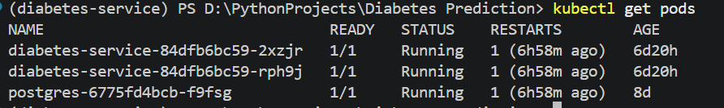

Распишем все по пунктам в проекте

| Пункт | Доказательство |
|---------|----------------|
| Платформа одной командой |  |
| Метрики и дашборд |  |
| Данные в DVC и S3 |   |
| Проверка данных |    **Зеленая job:**   https://github.com/Npudov/ML-Service-Diabetes-Prediction/actions/runs/39064529663/job/117489263903 |
| Конвевейер переобучения в Airflow | **Новая версия модели лучше:**     **Гейт не пустил:**  **Плохая выгрузка:**    |
| CI/CD целиком | Зеленый прогон: https://github.com/Npudov/ML-Service-Diabetes-Prediction/actions/runs/39130430352 |

|Переделка| Что сделано |
|---------|----------------|
| Изменено название теста | Изменено название теста в test_smoke.py на test_predict_handles_missing_gender |
| Блок Quickstart находится в Readme.md | Дополнено описание Quickstart в Readme и указано откуда можно скачать датасет |
